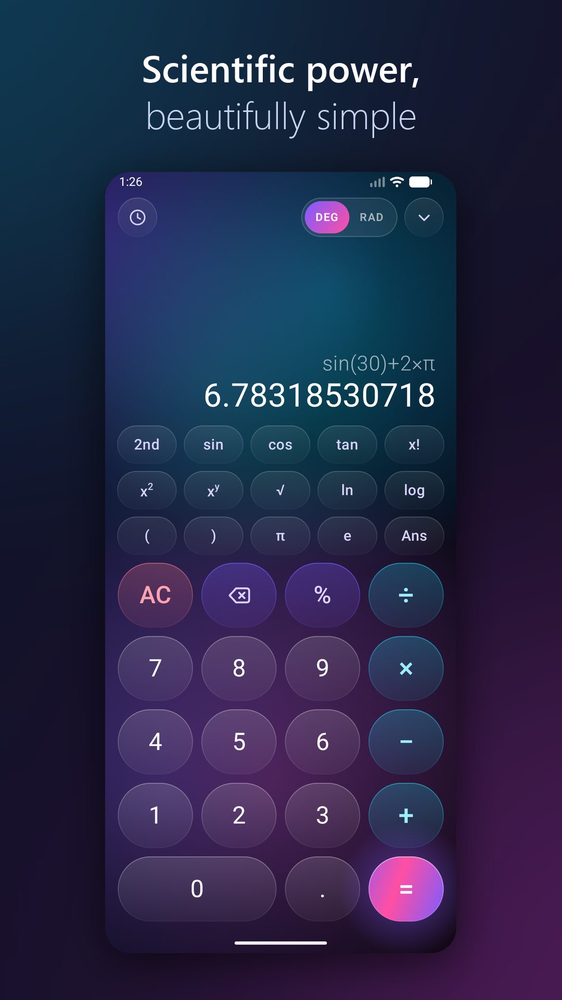
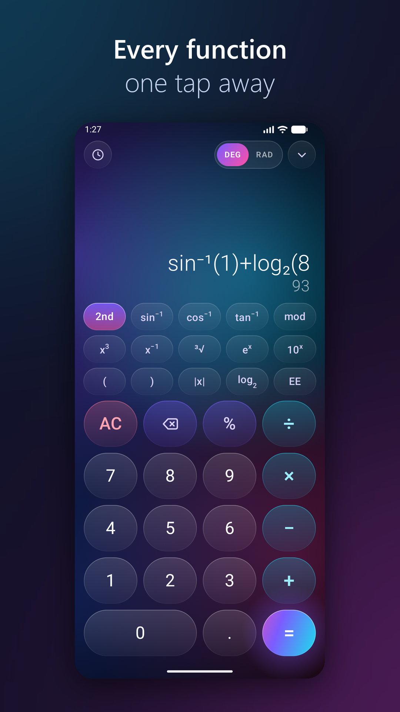
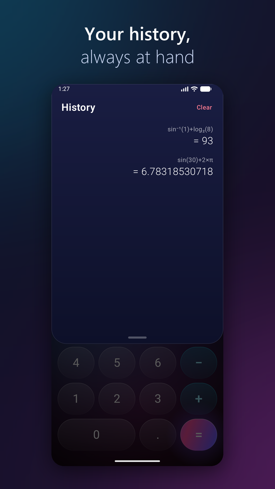

# Flux Calc

A scientific calculator for Android with a fluid, glassy design. Built with Kotlin and Jetpack Compose.

<p>
  
  
  
</p>

## Features

- Trigonometry in degrees or radians, including inverse functions
- Powers, roots, factorials, logarithms (ln, log, log₂) and exponentials
- Constants π and e, brackets, percentages and `Ans`
- A 2nd-function layer, plus a full scientific keypad in landscape
- Live result preview while typing
- On-device history: tap an entry to reuse it, long-press a result to copy it
- No ads, no account, no internet permission

## Build

Requirements: Android Studio (or JDK 17) and the Android SDK with API 36.

```bash
./gradlew assembleDebug          # debug APK
./gradlew testDebugUnitTest      # unit tests for the expression evaluator
```

### Release builds

Release builds are shrunk with R8 and signed with an upload key that is **not** in this repository.
To create your own, run `scripts/create-upload-key.ps1` (Windows PowerShell), or copy
`keystore.properties.example` to `keystore.properties` and point it at your keystore. Then:

```bash
./gradlew bundleRelease          # app/build/outputs/bundle/release/app-release.aab
```

## Project layout

| Path | Contents |
|---|---|
| `app/src/main/java/com/fluxcalc/app/engine/` | Expression parser and evaluator |
| `app/src/main/java/com/fluxcalc/app/ui/` | Compose UI: keys, display, history, animated background |
| `play-store/` | Store listing text, graphics and privacy policy |
| `scripts/` | Upload-key helper and the scripts that draw the logo and store graphics |

## Privacy

Flux Calc collects no data. See the [privacy policy](https://omsk1996.github.io/flux-calc-privacy/).
